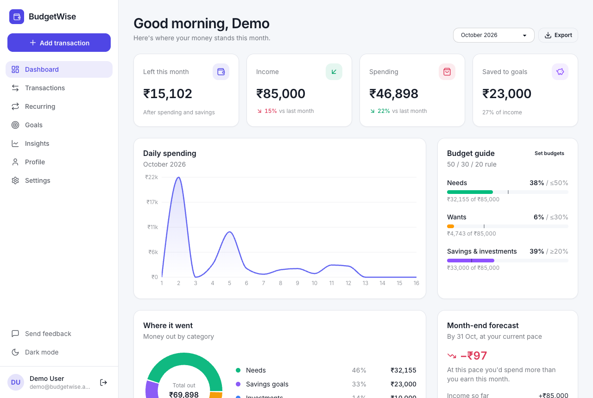
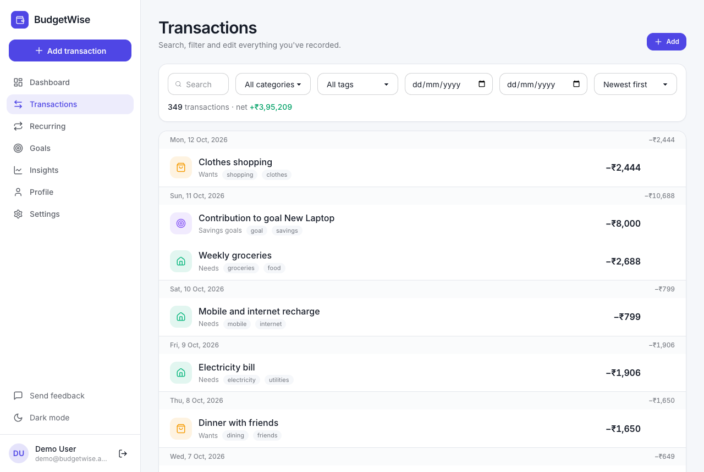
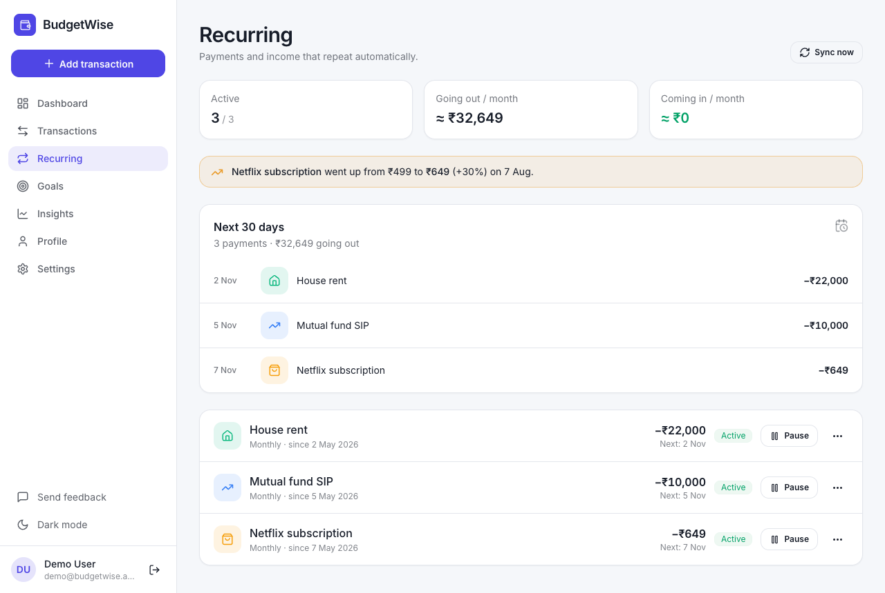
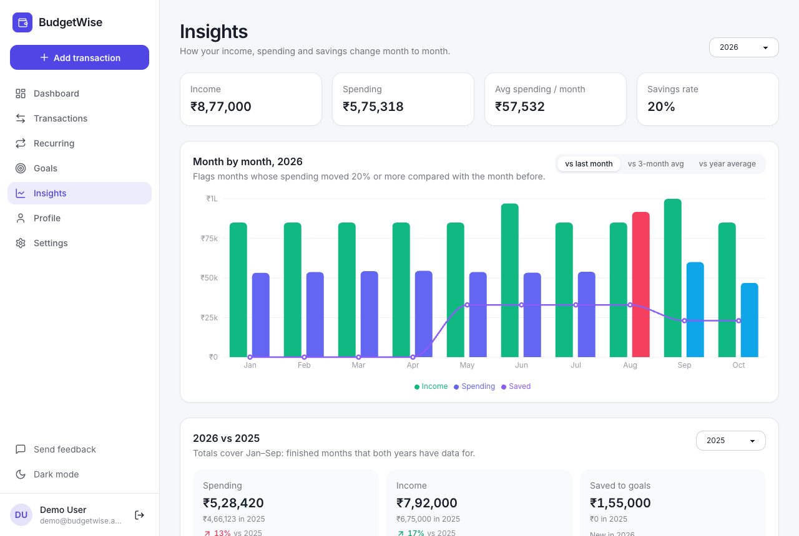
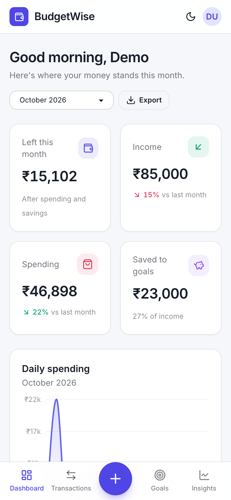

# 💰 BudgetWise

A personal finance tracker for India: record income and spending, see where the money goes, set budgets, automate the payments that repeat, and save towards goals. Works on desktop and phone, and installs as an app.

**Live demo:** coming soon at mybudgetwise.in (being redeployed). Meanwhile, see the screenshots below or run it locally.

This repo is the **React frontend**. The API lives in [finance_tracker_server](https://github.com/dheeraj08mishra/finance_tracker_server) (Express + MongoDB). What's done and what's next: [ROADMAP.md](ROADMAP.md).



---

## 🚀 What it helps with

- **Losing track of money:** every transaction in one place, grouped by day, searchable and taggable, with an optional photo or PDF of the receipt.
- **Overspending:** monthly budgets per category, a warning when you reach 80% and when you go over, and a month-end forecast at your current pace.
- **Bills that repeat:** rent, SIPs and subscriptions are added automatically, with a reminder the day before, the next 30 days at a glance, and an alert when a price changes.
- **Not seeing the trend:** month-by-month insights flag unusual spikes and drops, and you can compare this year with last year.
- **Saving with a purpose:** goals with targets and progress; contributions count as savings, not spending.
- **Using it anywhere:** responsive on phone, tablet and desktop, installable on your home screen, and readable offline.

## ✨ Features

| Area                    | What you can do                                                                                                                                                                                                            |
| ----------------------- | -------------------------------------------------------------------------------------------------------------------------------------------------------------------------------------------------------------------------- |
| **Accounts & security** | Sign up and sign in (httpOnly session cookie) · forgot password by email · change password (the last 3 can't be reused) · see every signed-in device and sign out one or all others · delete your account and all its data |
| **Dashboard**           | Month picker · left this month, income, spending and saved vs last month · daily spending chart · category budgets or the 50/30/20 guide · where the money went · month-end forecast · upcoming payments · Excel export    |
| **Transactions**        | Add, edit, delete · search, filter by category, date and tag · sort · 25 at a time with Load more · tags (auto-suggested from the note) · receipts (JPG, PNG, WebP or PDF)                                                 |
| **Recurring**           | Daily to yearly (7 options) with an optional end date · edit future payments · skip the next one · pause, resume, delete · committed per month · next 30 days · price-change alerts                                        |
| **Goals**               | Targets, quick contributions, progress, completed badge                                                                                                                                                                    |
| **Insights**            | Income vs spending by month · spike and drop detection (vs last month, 3-month average or z-score) · year-vs-year compare by month and category                                                                            |
| **Settings**            | Light, dark or match system · default category and repeat for new transactions · email notifications on/off · budgets · install the app                                                                                    |
| **Admin**               | Usage stats and charts · users list (no amounts) · feedback triage with private notes                                                                                                                                      |

## 🧠 Engineering highlights

- **Recurring engine:** occurrences are counted from the start date, so a payment on the 31st stays on month-end instead of drifting; missed dates are caught up, and a unique index guarantees each payment is created once even when two syncs race.
- **Sessions:** one record per signed-in device, so any device can be signed out remotely; password changes sign out everything else. A token mode with rotating refresh tokens and stolen-token detection is ready for the mobile apps.
- **Scheduled jobs:** reminders and summary emails are claimed atomically per day or month, so they run once even with several API servers or a separate worker.
- **Receipts:** the file type is checked from the bytes (not the name), files are stored under random names, served only to their owner with a sandboxing header, and deleted with the transaction.
- **Installable app:** a service worker generated at build time with that build's file list; offline shows the last-loaded data read-only, a new version waits for "Reload" instead of breaking an open tab, and saved data is wiped on sign-in and sign-out.
- **Timezones:** the server runs in UTC with calendar-day dates, so someone in IST can add "today" just after midnight.
- **Tests:** 116 API tests on an in-memory MongoDB replica set, 34 browser flows in Chrome (Playwright), installable-app checks against a production build, and CI on Node 20 and 22.

## 📸 Screenshots

| Transactions                                                                      | Recurring                                                                                |
| --------------------------------------------------------------------------------- | ---------------------------------------------------------------------------------------- |
|  |         |
| **Insights**                                                                      | **On a phone**                                                                           |
|        |  |

## 🔧 Tech stack

|         |                                                                                                                                 |
| ------- | ------------------------------------------------------------------------------------------------------------------------------- |
| UI      | React 19, React Router 7, Tailwind CSS 4 + daisyUI 5 (custom light/dark themes), Lucide icons, Inter                            |
| State   | Redux Toolkit                                                                                                                   |
| Charts  | Recharts                                                                                                                        |
| Dates   | date-fns                                                                                                                        |
| Build   | Vite 6, plus a small plugin that generates the service worker                                                                   |
| Backend | Node.js, Express 5, MongoDB (Mongoose), JWT sessions → [server repo](https://github.com/dheeraj08mishra/finance_tracker_server) |

## 🛠️ Running locally

You need the API running first (see the server repo). Then:

```bash
git clone https://github.com/dheeraj08mishra/budgetwise.git
cd budgetwise
npm install

# API on port 3000 (default):
npm run dev

# API on another port:
API_PROXY_TARGET=http://localhost:3001 npm run dev
```

Open http://localhost:1234. The dev server proxies `/api` to the Express server, the same way nginx does in production, so the app never needs CORS or a hard-coded API URL. With the server's demo data (`npm run seed:demo` there), sign in as `demo@budgetwise.app` / `Demo@1234`.

## 📦 Production build

```bash
npm run build      # outputs to build/, including the service worker
npm run preview    # serve the build locally (also proxies /api)
```

In production the app calls the API at `/api` on the same domain (nginx proxies `/api` to the Express server). Set `VITE_API_URL` at build time to call an API elsewhere.

## ✅ Checks

```bash
npm run lint           # ESLint (React + hooks rules)
npm run format:check   # Prettier (npm run format to fix)
npm test               # unit tests for the helpers (node:test)
npm run test:e2e       # 34 end-to-end flows in Chrome (Playwright)
npm run test:pwa       # install, offline and update checks on a production build
```

`test:e2e` and `test:pwa` drive the real app, so they need the local stack running: the API with a local MongoDB and the demo account (`npm run seed:demo` in the server repo), plus `npm run dev` here for `test:e2e` (`test:pwa` builds and serves its own copy). Start the API with high rate limits for test runs (`AUTH_RATE_LIMIT=500 API_RATE_LIMIT=10000`), and set `E2E_SERVER_LOG` to the API's log file so the forgot-password flow can read the reset link the server prints locally. The flows change the demo data, so re-seed afterwards. GitHub Actions runs lint, format check, unit tests and the build on every push.

## 📁 Project layout

```
index.html          entry page
public/             icons and the web app manifest
pwa/                service worker template + the Vite plugin that fills it in
src/
  main.jsx          bootstraps React, theme, font and the service worker
  index.css         Tailwind + the two daisyUI themes (bw-light, bw-dark)
  pages/            one lazily loaded file per route
  components/       app shell, shared UI kit (ui.jsx), transaction list, charts/
  utils/
    api.js          fetch wrapper (errors, expired sessions, file uploads)
    format.js       ₹ formatting
    categories.js   category labels, icons, colours
    dates.js        local "today" and UTC-safe date display
    pwa.js          install, offline and update helpers
    receipts.js     receipt upload (shrinks large photos first)
    redux/          store and slices
test/               unit tests
e2e/                browser flows and installable-app checks
docs/screenshots/   images used in this README
```

## 🤝 Contributing

Pull requests are welcome. For major changes, please open an issue first to discuss what you would like to change.

## 🧑‍💻 How it was built

Designed and maintained by [Dheeraj Mishra](https://github.com/dheeraj08mishra). Recent versions were built with AI pair programming (Claude Code): I made the product and design decisions and reviewed every change, and the test suites and CI above check the result.
